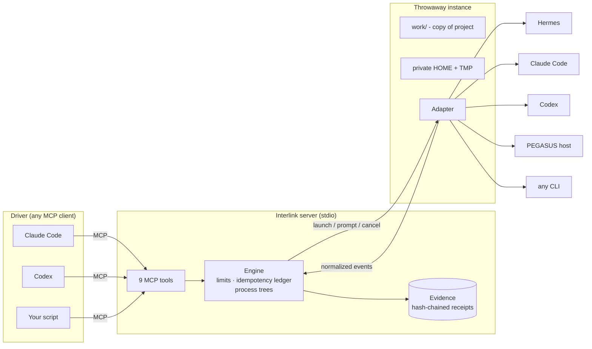

<p align="center">
  
</p>

<p align="center">
  <a href="https://github.com/jacksonjp0311-gif/interlink/actions/workflows/ci.yml"></a>
  
  
  
</p>

# Interlink

**Let one AI agent drive another, safely.**

Interlink is a small MCP server. Plug it into **Claude Code**, **Codex** or any other MCP
client, and that agent can launch *another* agent harness - **PEGASUS**, **Hermes Agent**,
**Claude Code**, **Codex**, or any CLI you point it at - inside a throwaway workspace, send
it prompts, watch what it does, see which files it changed, and walk away with a
tamper-evident evidence bundle.

It doesn't matter which side is which. Claude can drive Codex, Codex can drive Hermes, a
script can drive PEGASUS. Interlink is the cable in between.

```text
you ──► Claude Code ──(MCP)──► Interlink ──► Codex / Hermes / PEGASUS / your CLI
                                   │
                                   └──► sandbox: copied project, private HOME, env allow-list, evidence
```

---

## Contents

- [60-second quickstart](#60-second-quickstart)
- [Plug it into Claude Code or Codex](#plug-it-into-claude-code-or-codex)
- [How it works](#how-it-works)
- [The tools](#the-tools)
- [Configure your harnesses](#configure-your-harnesses)
- [Add your own agent](#add-your-own-agent)
- [The CLI](#the-cli)
- [Safety model](#safety-model)
- [FAQ](#faq)
- [Contributing](#contributing) · [Credits](#credits) · [License](#license)

---

## 60-second quickstart

You need Python 3.11+. Nothing else - the built-in `mock` agent needs no keys or network.

```bash
pip install interlink-mcp          # or: uvx --from interlink-mcp interlink ...
                                   # or, from a clone: pip install -e .

interlink doctor                   # checks your install and every harness it can find
interlink run mock "say hello from a sandbox
write hello.txt hi there"
```

You'll see the agent work in a fresh sandbox:

```text
interlink: mock instance 6c25f35f in ~/.local/state/interlink/instances/6c25f35f-.../work
hello from a sandbox
  -> write_file {"path": "hello.txt"}
  <- write_file ok
interlink: run complete (exit 0)
```

Got Claude Code, Codex or Hermes installed? They're detected automatically:

```bash
interlink harnesses
interlink run claude-code "Explain what this repo does in 3 bullets" --project .
```

`--project` is **copied** into the sandbox. Your checkout is never touched.

## Plug it into Claude Code or Codex

**Claude Code** - one command:

```bash
claude mcp add interlink -- uvx --from interlink-mcp interlink serve
```

…or commit a project-level `.mcp.json` ([example](examples/claude-code/.mcp.json)):

```json
{
  "mcpServers": {
    "interlink": { "command": "uvx", "args": ["--from", "interlink-mcp", "interlink", "serve"] }
  }
}
```

**Codex** - add to `~/.codex/config.toml` ([example](examples/codex/config.toml)):

```toml
[mcp_servers.interlink]
command = "uvx"
args = ["--from", "interlink-mcp", "interlink", "serve"]
tool_timeout_sec = 120
```

`interlink snippet claude-code | claude-code-cli | codex` prints these with the exact
paths of *your* install. Then just ask:

> *"Use Interlink to launch codex on a copy of this repo, ask it to write tests for
> `parser.py`, then show me the diff and the evidence."*

## How it works



1. **Launch** creates an instance: a fresh directory with a copy of your project (if any),
   a private HOME/TMP, and an environment containing only what you allowed.
2. **Prompt** starts a run in the background and returns a `run_id` immediately (or waits
   up to 60 s if you ask).
3. **Observe** streams normalized events - `text`, `tool_use`, `result`, `error`... - the
   same shape whichever harness produced them.
4. **Files** shows what changed. **Evidence** exports a redacted, hash-chained record.
5. **Stop** kills the whole process tree; `discard` deletes the workspace.

## The tools

| Tool | Use it to |
|------|-----------|
| `interlink_harnesses` | See which agents you can launch and whether they're ready. |
| `interlink_launch` | Start a throwaway instance (`harness`, optional `project` to copy, `files` to seed). |
| `interlink_prompt` | Send a prompt. `wait_s` (≤ 60) to block for the answer. |
| `interlink_observe` | Read events with cursor paging and long-polling. |
| `interlink_cancel` | Kill the running prompt (whole process tree). |
| `interlink_files` | List changed files, or read one. |
| `interlink_inspect` | Look at one instance, or everything. |
| `interlink_evidence` | Export the evidence bundle. |
| `interlink_stop` | Stop an instance; `discard=true` deletes it. |

Every reply is `{"schema": "interlink/1", "status": "complete" | "held" | "refused" | "failed", ...}`.
Mutating calls take an optional `request_id` for safe retries. Full details:
[docs/protocol.md](docs/protocol.md).

## Configure your harnesses

Interlink looks for config in `--config`, then `$INTERLINK_CONFIG`, then
`./interlink.toml`, then `~/.config/interlink/config.toml` (`%APPDATA%\interlink\config.toml`
on Windows). `interlink init` writes a starter file.

```toml
[server]
max_instances = 8
max_concurrent_runs = 4

[harness.claude]
adapter = "claude-code"
permission_mode = "acceptEdits"
secrets = ["ANTHROPIC_API_KEY"]   # passed through AND redacted from transcripts

[harness.codex]
adapter = "codex"
sandbox = "workspace-write"

[harness.hermes]
adapter = "hermes"
secrets = ["OPENROUTER_API_KEY"]

[harness.aider]                   # any CLI agent
adapter = "command"
argv = ["aider", "--yes-always", "--message-file", "{prompt_file}"]
```

A fully commented example lives in [examples/interlink.toml](examples/interlink.toml),
including PEGASUS.

## Add your own agent

If it has a CLI, you need **zero code**:

```toml
[harness.my-agent]
adapter = "command"
argv = ["my-agent", "--prompt-file", "{prompt_file}", "--json"]
resume_argv = ["my-agent", "--resume", "{session_id}", "--prompt-file", "{prompt_file}"]
output = "jsonl"
session_id_field = "session_id"
```

Need to parse a custom format or talk to a long-lived host? Subclass an adapter - about
30 lines ([examples/custom_adapter.py](examples/custom_adapter.py)) - and reference it as
`adapter = "my_module:MyAdapter"` or ship it as a plugin via the `interlink.adapters`
entry point. See [docs/adapters.md](docs/adapters.md).

## The CLI

| Command | What it does |
|---------|--------------|
| `interlink serve` | Run the MCP server on stdio (what Claude Code / Codex launch). |
| `interlink run <harness> "<prompt>"` | One prompt in a throwaway instance, streamed. `--project`, `--file dst=src`, `--json`, `-q`, `--timeout`, `--evidence`, `--keep`. Exit code 0 / 1 / 124 (timeout). `-` reads the prompt from stdin. |
| `interlink doctor` | Check Python, MCP SDK, config, state dir and each harness. |
| `interlink harnesses` | List configured harnesses and readiness. |
| `interlink ls` | List instances on disk. |
| `interlink cleanup` | Delete stopped/orphaned workspaces. |
| `interlink init` | Write a starter `interlink.toml`. |
| `interlink snippet <client>` | Print MCP config for `claude-code`, `claude-code-cli` or `codex`. |
| `interlink handshake` | Start a server and talk real MCP to it - a one-shot self-test. |

Prefer Python? [examples/drive_mock.py](examples/drive_mock.py) drives the server with
the official MCP client in ~50 lines.

## Safety model

Interlink is designed so that "let an agent run an agent" is boring.

| Protection | What it means |
|------------|---------------|
| **Copy, never mount** | `project` is copied in; links refused; size bounded. Your files are never the cwd. |
| **Private HOME/TMP** | Harness configs, caches and sessions live inside the instance. |
| **Env allow-list** | Children get `PATH` + locale + platform essentials. Everything else must be named. Credential-looking names must be declared as `secrets`. |
| **Redaction** | Declared secret values are scrubbed from events, logs and evidence. |
| **Path confinement** | File reads and seeds can't escape the workspace. |
| **Process trees** | Cancel/timeout/stop kill grandchildren too; orphans reaped only on identity match. |
| **Limits** | Instances, concurrent runs, prompt size, run time, events, file reads. |
| **Evidence** | Every step appends a hash-chained receipt; exports verify the chain. Prompts stored as hashes. |

> **Honest caveat:** Interlink is **not an OS sandbox**. Harnesses run as you. For
> untrusted code, run Interlink inside a container or VM and/or turn on the harness's own
> sandbox. Details: [docs/safety.md](docs/safety.md).

## FAQ

**Does it work on Windows?** Yes - Windows, macOS and Linux. On Windows, install
`interlink-mcp[windows]` for Job-object process-tree kills. The PEGASUS adapter is
Windows-only (it speaks PEGASUS's named-pipe protocol).

**Do I need API keys?** Not for Interlink. Each harness uses its own login or key; you
choose which env vars it may see with `secrets`.

**Claude Code says "not logged in" inside Interlink.** By default each instance gets a
private HOME, so CLIs that store their login under HOME don't see it. Either pass an API
key via `secrets`, or set `isolate_home = false` for that harness.

**Can the driven agent see my real project?** It sees a *copy*. Changes show up in
`interlink_files`; copy back what you want.

**What happens if the server crashes?** Instances are on disk. A new server shows them
read-only and reaps leftover harness processes it can prove are its own.
`interlink cleanup` tidies up.

**Is my prompt stored?** Its sha256 is in the evidence; the text lives only in the
instance's run directory, which `discard` deletes.

**How is this related to PEGASUS?** Interlink began as the instance-control layer inside
PEGASUS. This package lifts it out, makes it harness-agnostic, and keeps a first-class
PEGASUS adapter.

## Contributing

PRs welcome - especially new adapters. Start with [CONTRIBUTING.md](CONTRIBUTING.md):

```bash
git clone https://github.com/jacksonjp0311-gif/interlink && cd interlink
python -m venv .venv && . .venv/bin/activate
pip install -e ".[dev]"
pytest && ruff check . && ruff format --check .
```

The test suite uses fake Hermes and PEGASUS hosts, so it runs anywhere without keys.

## Credits

Interlink was born inside **PEGASUS**, where it controlled disposable PEGASUS instances
over a lease-and-token protocol. Its safety ideas - disposable profiles, env allow-lists,
idempotent request ledgers, hash-chained receipts and identity-checked orphan recovery -
come from there. Built on the [Model Context Protocol](https://modelcontextprotocol.io)
Python SDK.

## License

[MIT](LICENSE) © 2026 James Paul Jackson
