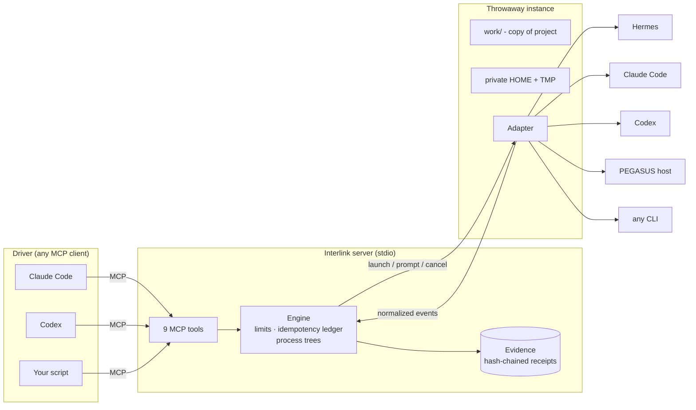
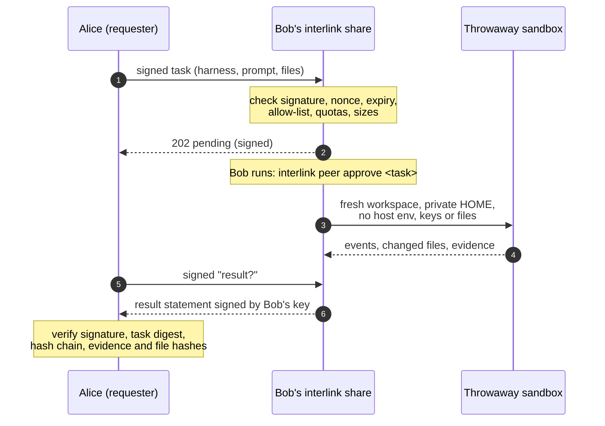

<p align="center">
  
</p>

<p align="center">
  <a href="https://github.com/jacksonjp0311-gif/interlink/actions/workflows/ci.yml"></a>
  <a href="pyproject.toml"></a>
  <a href="https://modelcontextprotocol.io"></a>
  <a href="LICENSE"></a>
</p>

<h1 align="center">Interlink</h1>

<p align="center"><b>Let one AI agent drive another, safely. Even on a friend's machine.</b></p>

Interlink is a small MCP server. Plug it into **Claude Code**, **Codex** or any other MCP
client, and that agent can launch *another* agent harness - **PEGASUS**, **Hermes Agent**,
**Claude Code**, **Codex**, or any CLI you point it at - inside a throwaway workspace, send
it prompts, watch what it does, see which files it changed, and walk away with a
tamper-evident evidence bundle.

It doesn't matter which side is which. Claude can drive Codex, Codex can drive Hermes, a
script can drive PEGASUS. Interlink is the cable in between. With
[peer connections](#connect-with-a-friend), that cable can reach a friend's machine too,
with signed requests, an allow-list, and evidence you can verify.

```text
you ──► Claude Code ──(MCP)──► Interlink ──► Codex / Hermes / PEGASUS / your CLI
                                   │
                                   └──► sandbox: copied project, private HOME, env allow-list, evidence
```

---

## Contents

- [60-second quickstart](#60-second-quickstart)
- [Plug it into Claude Code or Codex](#plug-it-into-claude-code-or-codex)
- [How it works](#how-it-works)
- [The tools](#the-tools)
- [Configure your harnesses](#configure-your-harnesses)
- [Add your own agent](#add-your-own-agent)
- [Connect with a friend](#connect-with-a-friend)
- [The CLI](#the-cli)
- [Live validation & benchmarks](#live-validation--benchmarks)
- [Safety model](#safety-model)
- [FAQ](#faq)
- [Contributing](#contributing) · [Credits](#credits) · [License](#license)

---

## 60-second quickstart

You need Python 3.11+ and git. Nothing else: the built-in `mock` agent needs no keys or
network.

```bash
git clone https://github.com/jacksonjp0311-gif/interlink && cd interlink
python -m venv .venv && . .venv/bin/activate     # Windows: .venv\Scripts\activate
pip install -e .

interlink doctor                   # checks your install and every harness it can find
interlink run mock "say hello from a sandbox
write hello.txt hi there"
```

> Interlink isn't on PyPI yet, so install it from a clone (or with
> `pip install git+https://github.com/jacksonjp0311-gif/interlink`).

You'll see the agent work in a fresh sandbox:

```text
interlink: mock instance 86377bb8 in ~/.local/state/interlink/instances/86377bb8-.../work
hello from a sandbox
  -> write_file {"path": "hello.txt"}
  <- write_file ok
interlink: run complete (exit 0)
```

Got Claude Code, Codex or Hermes installed? They're detected automatically:

```bash
interlink harnesses
interlink run claude-code "Explain what this repo does in 3 bullets" --project .
```

`--project` is **copied** into the sandbox. Your checkout is never touched.

## Plug it into Claude Code or Codex

Let Interlink print the config with the exact paths of *your* install:

```bash
interlink snippet claude-code-cli    # a ready-to-run `claude mcp add ...` command
interlink snippet claude-code        # a project-level .mcp.json
interlink snippet codex              # a block for ~/.codex/config.toml
```

**Claude Code**, run from the activated venv:

```bash
claude mcp add interlink -- "$(command -v interlink)" serve
```

**Codex**: add this to `~/.codex/config.toml` ([example](examples/codex/config.toml)),
using the `command` path that `interlink snippet codex` printed:

```toml
[mcp_servers.interlink]
command = "/path/to/.venv/bin/interlink"
args = ["serve"]
tool_timeout_sec = 120
```

If you use non-interactive `codex exec`, also add `default_tools_approval_mode = "approve"`.
Otherwise `exec` cancels MCP tool calls, because it can't ask you to approve them.

Then just ask:

> *"Use Interlink to launch codex on a copy of this repo, ask it to write tests for
> `parser.py`, then show me the diff and the evidence."*

## How it works



1. **Launch** creates an instance: a fresh directory with a copy of your project (if any),
   a private HOME/TMP, and an environment containing only what you allowed.
2. **Prompt** starts a run in the background and returns a `run_id` immediately (or waits
   up to 60 s if you ask).
3. **Observe** streams normalized events - `text`, `tool_use`, `result`, `error`... - the
   same shape whichever harness produced them.
4. **Files** shows what changed. **Evidence** exports a redacted, hash-chained record.
5. **Stop** kills the whole process tree; `discard` deletes the workspace.

## The tools

| Tool | Use it to |
|------|-----------|
| `interlink_harnesses` | See which agents you can launch and whether they're ready. |
| `interlink_launch` | Start a throwaway instance (`harness`, optional `project` to copy, `files` to seed). |
| `interlink_prompt` | Send a prompt. `wait_s` (≤ 60) to block for the answer. |
| `interlink_observe` | Read events with cursor paging and long-polling. |
| `interlink_cancel` | Kill the running prompt (whole process tree). |
| `interlink_files` | List changed files, or read one. |
| `interlink_inspect` | Look at one instance, or everything. |
| `interlink_evidence` | Export the evidence bundle. |
| `interlink_stop` | Stop an instance; `discard=true` deletes it. |

Every reply is `{"schema": "interlink/1", "status": "complete" | "held" | "refused" | "failed", ...}`.
Mutating calls take an optional `request_id` for safe retries. Full details:
[docs/protocol.md](docs/protocol.md).

## Configure your harnesses

Interlink looks for config in `--config`, then `$INTERLINK_CONFIG`, then
`./interlink.toml`, then `~/.config/interlink/config.toml` (`%APPDATA%\interlink\config.toml`
on Windows). `interlink init` writes a starter file.

```toml
[server]
max_instances = 8
max_concurrent_runs = 4

[harness.claude]
adapter = "claude-code"
permission_mode = "acceptEdits"
secrets = ["ANTHROPIC_API_KEY"]   # passed through AND redacted from transcripts

[harness.codex]
adapter = "codex"
sandbox = "workspace-write"

[harness.hermes]
adapter = "hermes"
secrets = ["OPENROUTER_API_KEY"]

[harness.aider]                   # any CLI agent
adapter = "command"
argv = ["aider", "--yes-always", "--message-file", "{prompt_file}"]
```

A fully commented example lives in [examples/interlink.toml](examples/interlink.toml),
including PEGASUS.

## Add your own agent

If it has a CLI, you need **zero code**:

```toml
[harness.my-agent]
adapter = "command"
argv = ["my-agent", "--prompt-file", "{prompt_file}", "--json"]
resume_argv = ["my-agent", "--resume", "{session_id}", "--prompt-file", "{prompt_file}"]
output = "jsonl"
session_id_field = "session_id"
```

Need to parse a custom format or talk to a long-lived host? Subclass an adapter - about
30 lines ([examples/custom_adapter.py](examples/custom_adapter.py)) - and reference it as
`adapter = "my_module:MyAdapter"` or ship it as a plugin via the `interlink.adapters`
entry point. See [docs/adapters.md](docs/adapters.md).

## Connect with a friend

Got a friend with a beefier machine or a harness you don't have? Hand them a task.
Their Interlink runs it in a sandbox and sends back a **signed result**: the answer,
the files the agent wrote, and proof of exactly what ran. Neither of you ever gets
access to the other's machine, files or keys.



**Pair once.** Each of you runs `interlink peer id` and swaps the invite code it prints.
Read your fingerprints to each other over a call.

```bash
# Bob (the host): add Alice, allow one harness, start sharing
interlink peer add alice IL1-...
interlink peer allow alice mock
interlink share                                   # 127.0.0.1:7464 until Ctrl-C

# Alice (the requester): add Bob and send a task
interlink peer add bob IL1-... --url http://127.0.0.1:7464
interlink peer ping bob                           # verifies his key, shows what you may run
interlink peer send bob mock "write answer.txt 42" --out ./from-bob

# Bob, in another terminal, when the task shows up
interlink peer pending
interlink peer approve <task-id>
```

The `--url` above works on one machine. Between two machines, use an SSH tunnel
(`ssh -N -L 7464:127.0.0.1:7464 bob-host`), a VPN, or `--bind` with TLS. See
[docs/peers.md](docs/peers.md#reaching-each-other).

**The safety model, in short:**

| Layer | What it means |
|-------|---------------|
| **Off by default** | Nothing listens until you run `interlink share`. New peers can run *nothing* until you `peer allow` a harness, and every task waits for your approval unless you opt in per peer (`peer add --auto-approve` or `peer policy NAME --approval auto`). |
| **Mutual auth** | Ed25519 keys (via [`cryptography`](https://cryptography.io)), pinned at pairing. Every request *and* response is signed, bound to its method, path and body, and protected by a nonce and an expiry against replay. Revocation is instant. |
| **Least privilege** | A per-peer allow-list, quotas, rate limits, timeouts, and caps on concurrency and size. Inbound tasks get a fresh sandbox with **no host env, secrets, logins or files**, only what the requester sent. |
| **Transport** | Loopback by default. Any other address requires TLS. |
| **Evidence** | The host signs the result, which is bound to the exact task you sent. Both sides keep hash-chained, tamper-evident audit logs (`interlink peer audit --verify`). |

Agents can send tasks too: `interlink serve --peer-tools` adds `interlink_peers`,
`interlink_peer_send` and `interlink_peer_result`. Pairing and approval stay CLI-only,
so an agent can't grant itself access. Full guide: [docs/peers.md](docs/peers.md).
Threat model and limits: [docs/SECURITY.md](docs/SECURITY.md).

## The CLI

| Command | What it does |
|---------|--------------|
| `interlink serve` | Run the MCP server on stdio (what Claude Code / Codex launch). |
| `interlink run <harness> "<prompt>"` | One prompt in a throwaway instance, streamed. `--project`, `--file dst=src`, `--json`, `-q`, `--timeout`, `--evidence`, `--keep`. Exit code 0 / 1 / 124 (timeout). `-` reads the prompt from stdin. |
| `interlink doctor` | Check Python, MCP SDK, config, state dir and each harness. |
| `interlink harnesses` | List configured harnesses and readiness. |
| `interlink ls` | List instances on disk. |
| `interlink cleanup` | Delete stopped/orphaned workspaces. |
| `interlink init` | Write a starter `interlink.toml`. |
| `interlink snippet <client>` | Print MCP config for `claude-code`, `claude-code-cli` or `codex`. |
| `interlink handshake` | Start a server and talk real MCP to it - a one-shot self-test. |
| `interlink share` | Let paired friends run allowed tasks on this machine (see above). |
| `interlink peer id \| add \| list \| show \| allow \| policy \| revoke \| remove` | Your identity, and the friends you're paired with. |
| `interlink peer ping \| send \| status \| result \| cancel` | Send tasks to a friend and verify the results. |
| `interlink peer pending \| approve \| deny \| audit \| cert` | Host side: approvals, the audit log, a TLS cert for LAN sharing. |

Prefer Python? [examples/drive_mock.py](examples/drive_mock.py) drives the server with
the official MCP client in ~50 lines.

## Live validation & benchmarks

On 2026-10-23, v0.2.2 was run live on a Windows 11 laptop (Ryzen AI MAX+ 395) and a Linux
box (8-vCPU Xeon). The full signed evidence package is in
[`evidence/live-2026-10-23/`](evidence/live-2026-10-23/).

| What ran | Result |
|---|---|
| Test suite | Windows: 180 passed, 15 skipped (POSIX-only). Linux: 195 passed |
| **Real Codex turn** through Interlink, using the existing login (`isolate_home = false`) | Completed in 16.8 s, wrote the file, exit 0, receipt chain valid |
| **Codex as the MCP client** (wired in with `-c` overrides; your `~/.codex/config.toml` is untouched) | harnesses → launch → prompt → evidence → stop: all completed |
| **PEGASUS host**, real boot from a disposable copy | Launched in 6.0 s with source and build digests. The prompt was refused (inference off), as designed |
| Peer mode (Ed25519) | Signed results verified. Disallowed harness, rate limit (429) and revoke all refused correctly. Audit chains valid |
| Env allow-list | Canary never reached the child, declared secret redacted, 0 secret-like variables leaked |
| Hermes / Claude Code | Skipped: the Hermes install is broken / Claude Code isn't installed |

| Median | Windows laptop | Linux box |
|---|---:|---:|
| MCP tool round-trip (n=200) | 4.1 ms | 1.5 ms |
| Full mock lifecycle: launch → prompt → files → evidence → stop | 566 ms | 79 ms |
| Ledger append / verify (5,000 receipts) | 0.91 ms / 70k per s | 0.10 ms / 167k per s |
| Signed peer hello, in-process | 16.7 ms | 1.7 ms |
| Delegated peer task, CLI end-to-end | 1.70 s | 1.23 s |

The laptop ran from a OneDrive-synced Desktop folder, which explains most of the
gap. To check the package (manifest signature, file hashes, signed peer results, audit
chains and ledgers):

```bash
python evidence/live-2026-10-23/verify.py   # -> ALL CHECKS PASSED
```

The signing key is single-use, and its private half was never stored. Public key:
`59216a9b14e11e168163173565cd232b8673de8c4823dd5c5ec5eadc2edfcd5c`.

## Safety model

Interlink is designed so that "let an agent run an agent" is boring.

| Protection | What it means |
|------------|---------------|
| **Copy, never mount** | `project` is copied in; links refused; size bounded. Your files are never the cwd. |
| **Private HOME/TMP** | Harness configs, caches and sessions live inside the instance. |
| **Env allow-list** | Children get `PATH` + locale + platform essentials. Everything else must be named. Credential-looking names must be declared as `secrets`. |
| **Redaction** | Declared secret values are scrubbed from events, logs and evidence. |
| **Path confinement** | File reads and seeds can't escape the workspace. |
| **Process trees** | Cancel/timeout/stop kill grandchildren too; orphans reaped only on identity match. |
| **Limits** | Instances, concurrent runs, prompt size, run time, events, file reads. |
| **Evidence** | Every step appends a hash-chained receipt; exports verify the chain. Prompts stored as hashes. |

> **Honest caveat:** Interlink is **not an OS sandbox**. Harnesses run as you. For
> untrusted code, run Interlink inside a container or VM and/or turn on the harness's own
> sandbox. Details: [docs/safety.md](docs/safety.md).

## FAQ

**Does it work on Windows?** It's built for Windows, macOS and Linux, and CI is set up for
all three. On Windows, install with `pip install -e ".[windows]"` for Job-object
process-tree kills. The PEGASUS adapter is Windows-only (it speaks PEGASUS's named-pipe
protocol).

**Do I need API keys?** Not for Interlink. Each harness uses its own login or key; you
choose which env vars it may see with `secrets`.

**Claude Code says "not logged in" inside Interlink.** By default each instance gets a
private HOME, so CLIs that store their login under HOME don't see it. Either pass an API
key via `secrets`, or set `isolate_home = false` for that harness.

**Can the driven agent see my real project?** It sees a *copy*. Changes show up in
`interlink_files`; copy back what you want.

**What happens if the server crashes?** Instances are on disk. A new server shows them
read-only and reaps leftover harness processes it can prove are its own.
`interlink cleanup` tidies up.

**Is my prompt stored?** Its sha256 is in the evidence; the text lives only in the
instance's run directory, which `discard` deletes.

**Can my friend use my API keys?** No. Peer tasks run with a sanitized config: no
`secrets`, no `pass_env`, no real HOME. Only harnesses that work without your
credentials (or bring their own) are useful to peers.

**How is this related to PEGASUS?** Interlink began as the instance-control layer inside
PEGASUS. This package lifts it out, makes it harness-agnostic, and keeps a first-class
PEGASUS adapter.

## Contributing

PRs welcome - especially new adapters. Start with [CONTRIBUTING.md](CONTRIBUTING.md):

```bash
git clone https://github.com/jacksonjp0311-gif/interlink && cd interlink
python -m venv .venv && . .venv/bin/activate
pip install -e ".[dev]"
pytest && ruff check . && ruff format --check .
```

The test suite uses fake Hermes and PEGASUS hosts, so it runs anywhere without keys.

## Credits

Interlink was born inside **PEGASUS**, where it controlled disposable PEGASUS instances
over a lease-and-token protocol. Its safety ideas - disposable profiles, env allow-lists,
idempotent request ledgers, hash-chained receipts and identity-checked orphan recovery -
come from there. Built on the [Model Context Protocol](https://modelcontextprotocol.io)
Python SDK.

## License

[MIT](LICENSE) © 2026 James Paul Jackson
