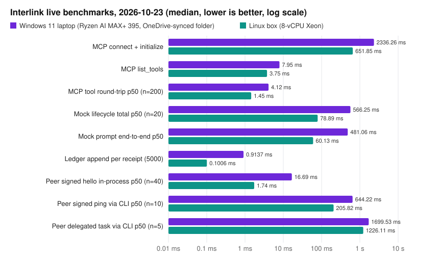

# Live validation evidence: 2026-10-23

This package records a live run of Interlink 0.2.1 plus the Codex `isolate_home` fix
that was released as 0.2.2. It ran on two machines on 2026-10-23, between 13:24 and 13:33 ET:

| | Windows laptop (`rog/`) | Linux box (`box/`) |
|---|---|---|
| OS | Windows 11 Pro 10.0.26200 | Linux 6.12, glibc 2.41 |
| CPU / RAM | AMD Ryzen AI MAX+ 395 (16C/32T), 124 GB | 8-vCPU Intel Xeon, 16 GB |
| Python | 3.14.7 | 3.13.5 |
| Test suite | **180 passed, 15 skipped** (POSIX-only) | **195 passed** |

On the laptop, everything ran in a scratch folder on the Desktop, which is synced by
OneDrive. TEMP and TMP pointed into that folder. Synced-folder I/O accounts for most of
the gap between the laptop and the box in the numbers below.

## What ran live

| Check | Result |
|---|---|
| MCP server over stdio | 9 tools, protocol `2026-07-28`, 200 tool round-trips, 20 full mock lifecycles. Every receipt chain is valid. |
| Env allow-list | The canary value never reached the child. The declared secret was redacted from the transcript. 0 secret-like parent variables leaked. |
| Receipt ledger | 5,000 receipts appended and the chain verified (`valid: true`) on both machines. |
| Peer mode (Ed25519) | Pairing, signed ping and hello, and a delegated task with a verified signed result. A disallowed harness was refused. The rate limit returned 429 after 49 extra hellos and recovered after the window. Revoked peers were refused. Both audit logs verify. |
| **Codex, real** (laptop) | `codex exec` used James's existing ChatGPT login (`isolate_home = false`, no credentials copied). It took a real turn in a sandbox: it created `interlink_ok.txt`, exited 0, and the receipt chain is valid. Prompt end-to-end: 16.8 s. |
| **Codex as the MCP client, real** (laptop) | Codex drove Interlink through `-c mcp_servers.interlink_live.*` overrides only, so `~/.codex/config.toml` was not touched. It called `interlink_harnesses → launch → prompt → evidence → stop`, and all five completed. Server ledger: 6 receipts, valid. |
| **PEGASUS host, real boot** (laptop) | The real PEGASUS executable ran as a host from a disposable copy of the project. Launch took 6.0 s and reported its source and build digests. The prompt was refused with `inference_disabled_opt_in_required`, as designed when inference is off. Stop took 0.65 s. The chain is valid. |
| Hermes | **Skipped.** The local Hermes install is broken (`No module named 'ruamel'`). |
| Claude Code | **Skipped.** It is not installed on either machine. |
| Codex on the box | **Skipped.** There is no Codex CLI or login on the box. |

The original PEGASUS checkout was only read. `rog/pegasus-before.json` and
`rog/pegasus-after.json` show the same git HEAD, dirty count, status hash, git-index
mtime, exe hash and exe mtime, and no top-level entries changed.

## Benchmarks

Full numbers are in [`benchmarks.csv`](benchmarks.csv) and each machine's `report.json`.



## Files

- `rog/`, `box/`: `report.json` (all measurements), `pytest-*.txt`, the receipt
  ledgers (`ledger-*.sqlite3`, consistent snapshots), exported evidence
  (`evidence-*.json`), the peer host and client audit logs, and the signed peer result
  (`peer-result-envelope.json` holds the host invite and fingerprints needed to verify it).
- `rog/report-pegasus.json`, `rog/evidence-pegasus.json`: the PEGASUS host run.
- `rog/codex-client-events.jsonl`: the Codex JSON event stream from the MCP-client run.
- `harness/live_bench.py`: the benchmark harness. `harness/make_charts.py` rebuilds the CSV and chart, and `harness/sign_evidence.py` re-signs the package.
- `MANIFEST.sha256`: a SHA-256 hash for every file. `MANIFEST.sha256.sig` is an Ed25519
  signature over `interlink-evidence-package/1\n` followed by the manifest.
  `evidence-signing-key.pub` is the one-time public key. Its private key was never written
  to disk. The key is also quoted in the main README, so the package can't be re-signed silently.

Local paths, user names and machine identifiers were redacted. No credentials,
private keys or prompt plaintext are included.

## Verify

```bash
pip install -e .          # from the repo root
python evidence/live-2026-10-23/verify.py
```

The script checks the manifest signature, every file hash (and that no file is unlisted),
the signed peer results, both audit chains and every receipt ledger. It prints
`ALL CHECKS PASSED` on success.

To reproduce, run `python evidence/live-2026-10-23/harness/live_bench.py --help`.
